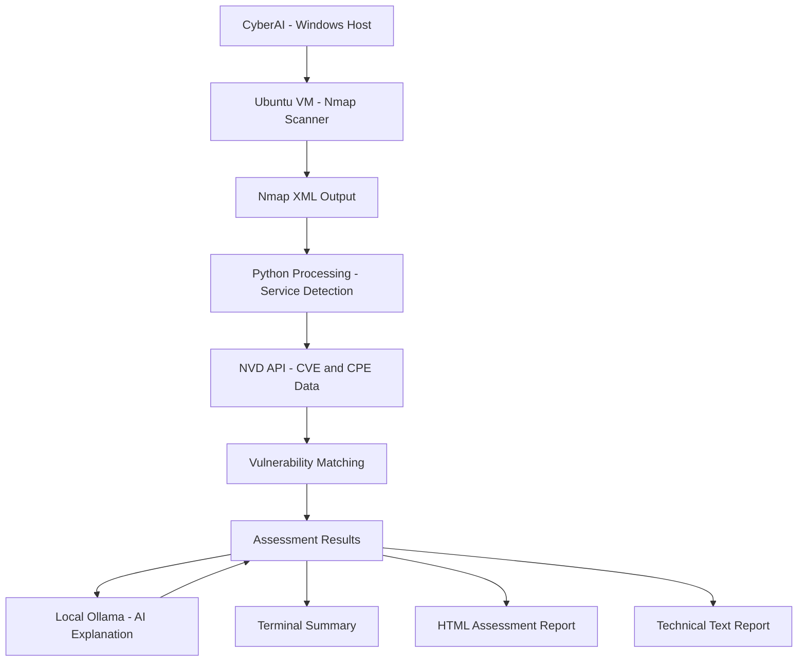

# CyberAI — AI-Assisted Vulnerability Assessment Prototype

CyberAI is an internship-stage defensive security project that combines network service discovery, NVD vulnerability research, conservative product/version matching, and optional local-AI explanations.

> **Project status:** Early working prototype. This repository documents only the functionality implemented so far. It is not a production vulnerability scanner and does not confirm that a target is vulnerable.

## What it currently does

1. Connects over SSH to a configured Ubuntu lab machine.
2. Runs an Nmap service/version scan against the single configured training target and parses the XML output.
3. Queries the NIST National Vulnerability Database (NVD) for relevant product/CPE candidates.
4. Compares detected product/version evidence with NVD CPE applicability information using conservative version-boundary checks.
5. Separates potential matches, uncertain results, and non-matches instead of treating every CVE search result as a vulnerability.
6. Optionally asks a locally running Ollama model to explain the results in simpler language. The AI explanation is informational; Python matching results remain authoritative.
7. Prints a short terminal summary and creates an HTML report. An optional full technical text report can also be saved.
8. Includes offline unit tests for core matching logic.

## System Architecture



## Current lab configuration

The current source is intentionally restricted to the lab topology used during development:

| Component | Current value |
|---|---|
| Ubuntu scanner VM (SSH) | `192.168.56.10` |
| SSH port | `22` |
| SSH username | `test` |
| Metasploitable training target | `192.168.77.20` |
| Local Ollama API | `http://localhost:11434/api/chat` |
| Ollama model | `llama3.2:3b` |

The code rejects a target other than the configured lab target. Keep vulnerable training machines isolated on a host-only/internal virtual network. Do not expose Metasploitable to a public or bridged network.

## Requirements

- Python 3.10 or newer
- Ubuntu VM reachable over SSH
- Nmap installed on the Ubuntu VM
- Nmap service/version detection available
- Ollama running locally for optional AI explanations
- `llama3.2:3b` pulled in Ollama for optional AI explanations
- Internet access from the machine running CyberAI for NVD API queries

Install the Python dependency:

```bash
python -m pip install -r requirements.txt
```

## Run

Run offline tests first:

```bash
python scanner.py --self-test
```

Start an assessment:

```bash
python scanner.py
```

The program prompts for the Ubuntu SSH password at runtime; the password is not stored in the source code. It writes `cyberai_report.html` in the current directory by default.

To also save the full technical text report:

```bash
python scanner.py --report assessment.txt
```

To choose a different HTML report path:

```bash
python scanner.py --html-report reports/assessment.html
```

Create the destination directory before using a nested report path.

## NVD API key (optional)

CyberAI can query the public NVD API without a key, subject to its unauthenticated rate limits. If you have an NVD API key, set it as an environment variable named `NVD_API_KEY` before running the program. Never commit API keys, passwords, or other credentials to GitHub.

PowerShell:

```powershell
$env:NVD_API_KEY = "YOUR_KEY"
python scanner.py
```

Linux/macOS:

```bash
export NVD_API_KEY="YOUR_KEY"
python scanner.py
```

## Important limitations

- This version scans only the fixed, authorised training target configured in `scanner.py`; arbitrary IPs and websites are not supported yet.
- It is a network service/version assessment prototype, not a complete authenticated vulnerability scanner.
- NVD search results are candidate records. A `POTENTIAL MATCH` is not proof that a vulnerability exists on the target.
- Distribution package revisions, backported fixes, build options, platform conditions, and configuration may affect applicability. Verify findings against vendor/distribution advisories.
- A failed or empty NVD lookup does not mean a service is secure.
- CVSS describes vulnerability severity, not whether the target is actually affected. This prototype does not yet implement the planned risk scoring system.
- The web-application assessment module and WAF assessment are not implemented yet.
- The local AI feature is optional and must not be treated as an authority for vulnerability classification.

## Safety and authorised use

Use CyberAI only against systems you own or have explicit permission to assess. The current configuration is intended for an isolated educational lab. Do not use it to scan third-party systems without written authorisation.

## Roadmap (not implemented yet)

- Separate severity from applicability confidence and add transparent risk prioritisation.
- Improve configuration management so authorised lab targets can be changed safely.
- Add a separately scoped web-application assessment module for authorised applications.
- Add defensive WAF detection and configuration assessment (not WAF evasion).
- Improve report presentation and test coverage.

## License

MIT License. See [LICENSE](LICENSE).
